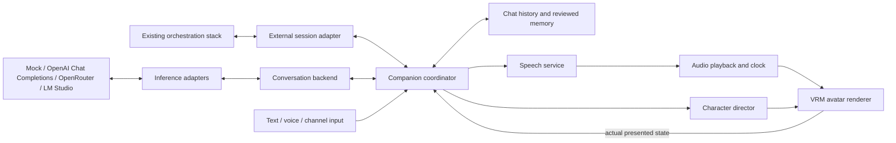

# Open Companion — architecture draft 0.1

This is the entry point for an independent, customizable AI companion application. The working name is **Open Companion**. The deliverable is a design package; no application has been implemented. Read [the blueprint overview](architecture/README.md) first.

The proposed first product is a Windows desktop app with a live 3D character, text and voice conversation, searchable local chat history, editable character profiles and memory, and user-imported avatars. It connects to an existing orchestration stack or uses configurable inference providers directly. Initial development uses deterministic mocks and needs no account or API key.

The central separation is:

Provider credentials, model names, and provider-specific streaming frames stay inside the inference layer. The avatar receives audio, timing, and visual intent through a separate companion protocol. Model choice can vary by character, channel, and task without changing the avatar or memory implementation.

The package includes exact proposed TypeScript contracts, provider routing precedence, state and storage rules, animation arbitration, failure scenarios, acceptance checks, and ordered work packages. Architectural choices are recommendations for this first draft, with explicit validation gates. The evidence does not establish performance or visual quality on the user's hardware.

Start here:

- [Readable overview and decisions](architecture/README.md)
- [Provider adapters and the information needed for integration](architecture/12-provider-integration.md)
- [Interfaces and protocol semantics](architecture/05-interfaces-and-contracts.md)
- [Avatar, speech, and animation policy](architecture/13-avatar-and-director.md)
- [Delivery order](architecture/09-delivery-plan.md)
- [Current state and next action](architecture/10-resume-state.md)

To hand this to another agent, provide this file and the entire `architecture/` directory. The three earlier research reports are supporting evidence, not dependencies required to implement the proposed product. Begin with the instructions in [architecture/README.md](architecture/README.md); do not treat this draft as an already approved implementation or silently substitute a different architecture.
